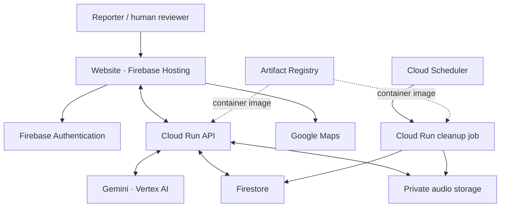

# Emergency Response Copilot — technical brief

Prepared: 12 October 2026. This brief describes the implemented prototype, rather than every component in the original proposed architecture.

Emergency Response Copilot turns voice or text reports into structured incidents with source evidence and uncertainty. Gemini assists with transcription, clarification and assessment; a human reviews the location, urgency and services before approving a simulated handoff. The application does not contact real emergency services.

## Deployment overview

The setup has **10 main logical components**, plus service accounts and platform logging. Maps JavaScript and Geocoding are counted together as one integration; the API and cleanup job are separate workloads. Gemini is a managed model called through Vertex AI, not self-hosted model weights.

Project IDs, deployment accounts, endpoint addresses, bucket identifiers and operational records are kept in ignored operator configuration. Configure your own project using [deployment guidance](deployment.md), [.env.example](../.env.example), [runtime template](cloud-runtime.example.yaml) and [Firebase template](../firebase.cloud.example.json). Hosted-demo availability is managed separately from this source repository.

## Components and responsibilities

| # | Component | Responsibility |
| --- | --- | --- |
| 1 | **Firebase Hosting** | Serves the React/TypeScript website: incident entry, recording, conversation, human review and simulation receipts. The browser calls the Cloud Run API directly. |
| 2 | **Firebase Authentication** | Gives each visitor an anonymous identity. The backend verifies its token and uses that identity to isolate the visitor's demo session and incidents. Anonymous identity does not establish that someone is an authorized real-world responder. |
| 3 | **Cloud Run API** — `emergency-copilot-api` | Runs the Dockerized Node.js/Fastify backend. Handles media validation, authentication, report preview, conversations, assessment validation, persistence, incident retrieval and human decisions. |
| 4 | **Gemini through Vertex AI** | Provides audio transcription, reported-location suggestions, clarification questions, structured incident assessments and model consistency review. We call a managed model; we do not deploy or train model weights ourselves. |
| 5 | **Firestore** — named database `emergency-copilot` | Stores sessions, incidents, conversation turns, clarification history, assessment versions, human reviews, simulated receipts and usage counters. The API accesses it; direct client access is denied by deployed rules. |
| 6 | **Private Cloud Storage** | Stores original and normalized incident audio. Playback goes through the authenticated, ownership-checked API. The bucket has uniform access and public access prevention. |
| 7 | **Google Maps integration** | Maps JavaScript displays the location picker; Geocoding turns address searches into candidate points. The reviewer selects and confirms a location. Nearby-service links support manual lookup, not automatic selection of an available responder. |
| 8 | **Cloud Run cleanup job** — `emergency-copilot-cleanup` | Removes expired or revoked sessions' incident records, turns and recordings. Uses the same container image as the API, with cleanup as its entry command. Revocation markers prevent old tokens from reopening a reset session. |
| 9 | **Cloud Scheduler** — `emergency-copilot-hourly-cleanup` | Invokes the private cleanup job at minute 17 of each hour, using the `Asia/Kolkata` timezone. The scheduler and job are distinct: the scheduler triggers; the job performs the work. |
| 10 | **Artifact Registry** — repository `emergency-copilot` | Stores the versioned Docker image deployed to the API and cleanup job. It participates in deployment, not in every incident conversation. |

## Architecture

The diagram shows connections when the hosted prototype is running. Dashed arrows represent deployment dependencies.

## How a report moves through the system

1. **Capture and preview.** The user types a report or records/uploads audio. The API validates media and normalizes audio with FFmpeg. Gemini produces an editable transcript and reported-location suggestion. The user reviews these before creating the incident. Reported location and device GPS remain separate and unverified until human confirmation.
2. **Start the incident.** The backend checks the session, saves the incident and stores associated audio privately. The original report and conversation history remain available for later review.
3. **Clarify and assess.** Gemini receives the original report and relevant history. It asks targeted questions and proposes urgency, service recommendations, sourced facts and Yes/No/Unknown indicators. Intake aims for five essential questions, never exceeds ten, and supports early finish with remaining unknowns retained.
4. **Validate before publication.** Shared schemas, exact source-quote checks and targeted consistency/grounding rules validate the structured response. A model review and one bounded corrective repair can reconcile a draft. Failed responses remain unpublished; the report is retained for retry or manual review. These checks are conservative safeguards, not a complete proof of semantic accuracy.
5. **Human review.** The reviewer checks the prefilled summary, urgency, selected services and location. A confirmed map selection can replace the default device coordinates. AI recommendations do not approve an incident or notify a service.
6. **Simulated handoff.** Human approval saves the reviewed version and creates per-service SMS previews and receipts in Firestore. Revision checks prevent stale approval, and idempotency prevents duplicate submission from creating repeated handoffs. Reload retrieves the saved conversation, review and receipts.

## What the Emergency Agent means

The **Emergency Agent is application logic inside the Cloud Run API**, not another separately deployed service. It combines model calls with conversation state, intake limits, source checks, service recommendations and recovery behavior.

The API streams progress/status events to the browser and releases validated coordinator replies. The user-facing progress states are not the model's private reasoning or chain of thought. In live mode, reply text is released after validation; a failed live response is not silently replaced with a scripted answer.

## Security identities and operational controls

- **Runtime service account:** a dedicated deployment-specific runtime identity. The API and cleanup job use keyless credentials for Vertex AI, the named Firestore database and the dedicated private bucket.
- **Scheduler service account:** a separate deployment-specific scheduler identity. Can invoke the cleanup job only.
- **Session ownership:** API routes verify Firebase identity, session validity and incident ownership. A separate session cannot read or approve another session's incident. Session expiry is 24 hours; reset revokes access and removes owned incident/audio data.
- **Concurrency and usage:** When restored, the API uses zero minimum/two maximum instances, concurrency 4 and a 120-second request timeout. Inference reservations are limited to 30 per session/hour and 100 globally/hour. These are not a guaranteed spending cap or complete abuse protection.
- **Logging:** Cloud Run provides platform request and lifecycle logs. General Fastify request logging is disabled; application errors use safe categories rather than exposing report content or credentials.

## Prototype boundaries

- **Pub/Sub is not used** in the implemented prototype, although it appeared in the original proposed diagram.
- **No real SMS or dispatch provider is integrated.** Police, Medical, Fire and Emergency handoffs are simulations stored by the application.
- **Recipient views use the original authenticated demo session.** Separate citizen and authorized responder accounts remain future work.
- **Maps does not establish responder availability or automatically dispatch the nearest service.** Humans confirm location and review any external listing.
- **English, Hindi and mixed Hindi-English intake examples have been demonstrated.** Broader languages, representative accents, translation quality and fully localized conversations require validation; a successful transcript does not guarantee a successful assessment.
- **Live availability and model quality vary.** Provider failures, rate limits and rejected evidence/consistency checks can require retry or manual review. The prototype is not a production emergency-response service.

## Operational lifecycle

An operator can pause Hosting, remove public API invocation, explicitly scale the API to zero, disable new anonymous signups, pause cleanup and reversibly deactivate the dedicated Maps key. Images, data and configuration can be retained for restoration. Keep the account-specific runbook and actual endpoint checks outside Git. Restore only when authorized, then validate the complete workflow before sharing the judging link.

A paused hosted application cannot call Gemini through its disabled backend. Local live testing and other authorized project usage remain separate. Retained resources may still incur charges; this is not a zero-cost guarantee.

## Code and evidence references

- [Web interface](../apps/web/src): React/TypeScript incident and review workspace.
- [API entry point](../apps/api/src/app.ts): routes, authentication, media and request handling.
- [Conversation provider](../apps/api/src/conversation/gemini.ts): model context, generation and consistency-review calls.
- [Consistency validation](../apps/api/src/conversation/consistency-review.ts): source and assessment checks.
- [Human review service](../apps/api/src/review/service.ts): versioned review and idempotent simulated decisions.
- [Cleanup implementation](../apps/api/src/demo/cleanup.ts): session revocation and removal of expired data.
- [Shared contracts](../packages/contracts/src): schemas used by browser and backend.
- [Cloud runtime template](cloud-runtime.example.yaml) and [Firebase deployment template](../firebase.cloud.example.json).
- [Deployment guidance](deployment.md), [evaluation boundaries](evaluation.md) and [publication hygiene](publication-hygiene.md).
